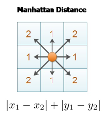
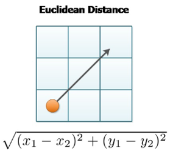
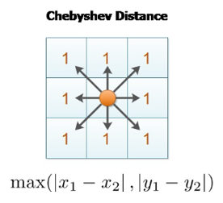

# Arduino-Zero-Honors
### General Description
A simple program meant to demonstrate how a A* Search Algorithm, a search algorithm that looks for the most efficient path from a starting point to an ending point, works with the generation of a maze as a demonstration and the various ways it could be navigated (for future reference, a node will represent a position in the maze
### A* Search Description
Now, while other search algorithms consider the nodes next to it, A* compares the beginning node and the last node, then creates a path. This is accomplished by assigning every node searched with a value "f", wherein "f" represents the cost between the current node and the final with the end goal being to reach the end using the lowest cost possible. This value "f" is calculated with values "g" and "h" wherein:
+ “g” represents the cost of moving from the starting node to another node
+ “h” represents the estimated cost from the current node to the final node

The value of “h” is determined based off one of the three possible heuristics:
+ Manhattan: Takes straight lines in terms of x and y 

+ Euclidean: Can move diagonally along with straight lines in the x or y direction 

+ Chebyshev: Just takes one straight line in either the x or y direction 

### Program Description
Using the knowledge of each heuristic, the duration and effectiveness for each to solve the maze can be calculated. 

### Credits
Listed the functionality and description of each heuristic and A* Search in genereal: [Link](https://www.geeksforgeeks.org/a-search-algorithm/ )
